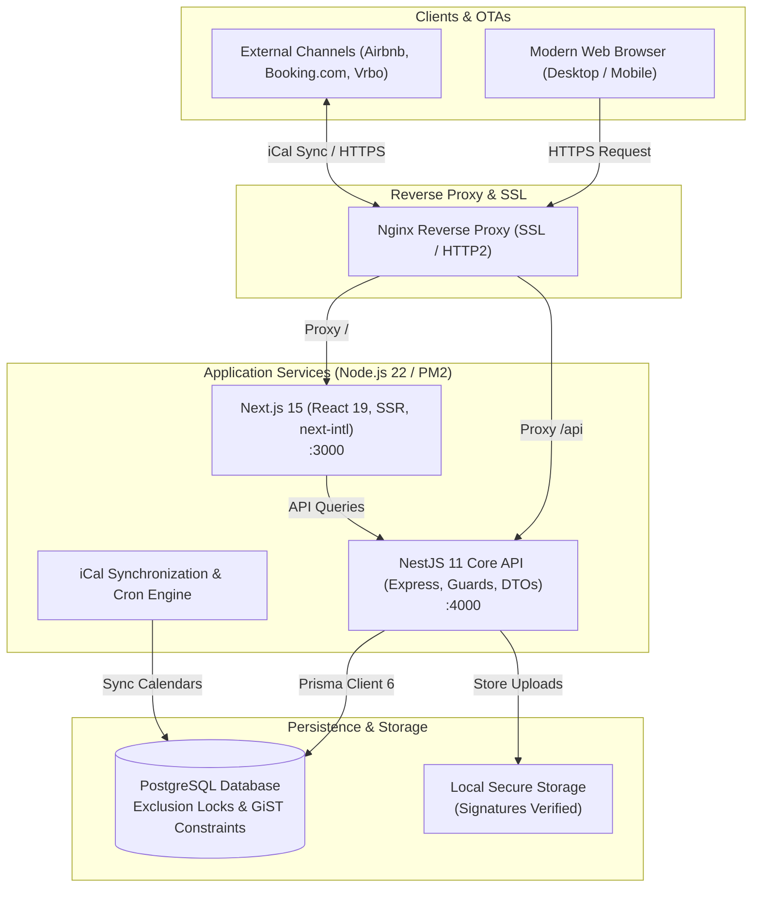

# VillaRentArea — Enterprise Luxury Villa Rental & Property Management Platform

<p align="center">
  <strong>Production-ready, highly concurrent luxury villa booking and property management system with bi-directional OTA iCal synchronization, multi-role portals, and zero-downtime CI/CD.</strong>
</p>

<p align="center">
  <a href="https://github.com/birhatmf/Villa-Rent-pb/actions"></a>
  <a href="https://nextjs.org/"></a>
  <a href="https://react.dev/"></a>
  <a href="https://nestjs.com/"></a>
  <a href="https://www.postgresql.org/"></a>
  <a href="https://www.prisma.io/"></a>
  <a href="https://www.typescriptlang.org/"></a>
  
</p>

---

<p align="center">
  <a href="#english"><strong>🇬🇧 English Documentation</strong></a> • 
  <a href="#türkçe"><strong>🇹🇷 Türkçe Dokümantasyon</strong></a>
</p>

---

<a name="english"></a>
## 🇬🇧 English

### 🌟 Executive Overview
**VillaRentArea** is an enterprise-grade full-stack real estate and short-term rental management platform engineered to solve the complex concurrency, calendar sync, and business logic challenges of luxury holiday rentals. 

Built with **Next.js 15**, **NestJS 11**, and **PostgreSQL**, the platform guarantees **zero double-bookings** under high concurrency through database-level exclusion locks, features real-time **bi-directional iCal calendar synchronization** with global OTAs (Airbnb, Booking.com, Vrbo), and provides specialized portals for **Guests**, **Property Owners (Hosts)**, and **System Administrators**.

---

### 🚀 Key Architectural Highlights

#### 1. 🛡️ Concurrency-Safe Booking Engine (Zero Overbooking)
* **PostgreSQL Row-Level Locks (`SELECT FOR UPDATE`)**: Eliminates race conditions during peak booking periods.
* **Exclusion Constraints (`gist` with temporal ranges `[check_in, check_out)`)**: Enforces non-overlapping booking validity at the database engine level.
* **Idempotent Booking Lifecycle**:
  ```text
  [REQUEST / HOLD (10 min lock)] ──> [DECLARED (Receipt uploaded)] ──> [CONFIRMED (Admin verified)]
                                     └──> [EXPIRED / CANCELLED]
  ```

#### 2. 📅 Bi-Directional iCal Synchronization Engine
* **RFC 5545 Compliance**: Fully supports `RRULE`, `RDATE`, `EXDATE`, `RECURRENCE-ID`, event cancellations, and transparent external blocks.
* **Multi-Channel Compatibility**: Synchronizes bidirectionally with Airbnb, Booking.com, Vrbo, and Google Calendar.
* **AES-256 Encryption**: External iCal URLs are encrypted at rest with AES-256 to prevent SSRF and sensitive calendar token disclosure.
* **Automated Background Sync Worker**: Periodically pulls external calendars every 15 minutes, marks conflict health, and issues secure export links.

#### 3. 👥 Multi-Role Portal Ecosystem
* **Guest Portal**: Real-time interactive villa search, filter by regions/concepts, dynamic night-by-night pricing, verified guest bookings, and travel history dashboard.
* **Host (Owner) Portal**: Streamlined guest-to-host onboarding workflow, interactive calendar blocking, reservation management, earnings tracking, and review responses.
* **Admin CMS & Operations**: Comprehensive management for reservations, custom bank transfer approvals, dynamic content pages, region taxonomy, and user roles.

#### 4. ⭐ Verified Guest Reviews
* Reviews can only be submitted by verified guests who actually completed a reservation.
* Strictly controlled 30-day post-checkout window with a 24-hour edit policy and host response capabilities.

#### 5. 🔒 Enterprise Security & Audit
* **Security Audited**: Verified with 0 Critical, 0 High vulnerabilities.
* **Cookie-Based JWT**: Secure HTTP-only cookies with database-backed session version tracking (`sessionVersion`) for instant revocation.
* **OWASP Hardened**: Strict rate-limiting (`@nestjs/throttler`), magic-byte file signature validation, anti-SSRF address filters, and helmet headers.

---

### 🏗️ System Architecture



---

### 💻 Technology Stack

| Layer | Technologies |
| :--- | :--- |
| **Frontend** | Next.js 15.5 (App Router), React 19, Tailwind CSS, TypeScript, Next-Intl (i18n), Lucide Icons |
| **Backend** | NestJS 11, Express, TypeScript, Prisma ORM 6, Class Validator, Helmet, Throttler |
| **Database** | PostgreSQL 16 with B-Tree & GiST Temporal Indexing |
| **Calendar Engine** | `ical.js` with RFC-5545 parsing, AES-256 encrypted feeds |
| **Authentication** | JWT stored in HTTP-only signed cookies, DB-verified `sessionVersion` |
| **DevOps & CI/CD** | GitHub Actions (Automated build & test), PM2 Process Manager, Nginx, AlmaLinux |

---

### ⚙️ Local Development Quickstart

#### Prerequisites
* Node.js >= 22
* PostgreSQL >= 15
* npm >= 10

#### 1. Clone the Repository
```bash
git clone https://github.com/birhatmf/Villa-Rent-pb.git
cd Villa-Rent-pb
```

#### 2. Backend Setup
```bash
cd backend
npm install --legacy-peer-deps
cp .env.production.example .env
# Configure DATABASE_URL, JWT_SECRET, and ICAL_ENCRYPTION_KEY in .env

# Generate Prisma Client and push database schema
npx prisma generate
npm run db:push

# (Optional) Seed sample data
npm run db:seed

# Start backend
npm run dev
```

#### 3. Frontend Setup
```bash
cd ../frontend
npm install --legacy-peer-deps
cp .env.production.example .env.local

# Start frontend
npm run dev
```
Open [http://localhost:3000](http://localhost:3000) in your browser.

---

<hr/>

<a name="türkçe"></a>
## 🇹🇷 Türkçe

### 🌟 Genel Bakış
**VillaRentArea**, lüks tatil villaları ve kısa dönem mülk kiralama süreçlerindeki takvim çakışmaları, rezervasyon yönetimi ve eşzamanlılık sorunlarını çözmek amacıyla geliştirilmiş kurumsal seviyede bir tam yığın (full-stack) web platformudur.

**Next.js 15**, **NestJS 11** ve **PostgreSQL** mimarisi üzerinde inşa edilen sistem; veritabanı düzeyindeki satır kilitleri sayesinde yüksek trafikte **asla çift rezervasyona izin vermez**, global seyahat platformlarıyla (Airbnb, Booking.com, Vrbo) **çift yönlü iCal takvim senkronizasyonu** yapar ve **Misafir**, **Ev Sahibi** ve **Yönetici** panelleriyle eksiksiz bir operasyonel yönetim sunar.

---

### 🚀 Öne Çıkan Mühendislik Yetenekleri

#### 1. 🛡️ Çift Rezervasyon Önleme Motoru (Concurrency Engine)
* **PostgreSQL Satır Kilitleri (`SELECT FOR UPDATE`)**: Yoğun rezervasyon anlarında eşzamanlı işlem yarışlarını (race condition) tamamen engeller.
* **Tarih Aralığı Kısıtlamaları (`GiST` & `[giriş, çıkış)`)**: Çakışan tarihlerin kaydedilmesini doğrudan PostgreSQL çekirdeğinde durdurur.
* **İdempotent Rezervasyon Akışı**:
  ```text
  [TALEP / 10 Dk Geçici Kilit (HOLD)] ──> [DEKONT BİLDİRİMİ (DECLARED)] ──> [ONAY (CONFIRMED)]
                                         └──> [ZAMAN AŞIMI / İPTAL]
  ```

#### 2. 📅 İki Yönlü iCal Takvim Senkronizasyonu
* **RFC 5545 Standardı**: `RRULE` (tekrarlayan kural), `EXDATE` (hariç tutma), `RECURRENCE-ID` ve şeffaf harici blokajları eksiksiz yorumlar.
* **Çok Kanallı Entegrasyon**: Airbnb, Booking.com, Vrbo ve Google Calendar ile otomatik iki yönlü takvim eşitlemesi.
* **AES-256 Şifreleme**: Dış kanallardan alınan gizli iCal adresleri veritabanında AES-256 ile şifreli tutulur (SSRF ve gizlilik savunması).
* **Arka Plan Senkronizasyon İşçisi**: Her 15 dakikada bir dış kaynakları tarar, bağlantı sağlığını ölçer ve güvenli dışa aktarma linkleri üretir.

#### 3. 👥 Çok Katmanlı Rol Mimarisi
* **Misafir Portalı**: Bölge ve konsept filtreleme, gece bazlı dinamik fiyatlama, rezervasyon ve seyahat geçmişi paneli.
* **Ev Sahibi (Host) Portalı**: Kolay başvuru ve otomatik host rolü geçişi, interaktif takvimden tarih kapatma/açma, rezervasyon takibi ve doğrulanmış yorum yanıtlama.
* **Yönetici (Admin) Paneli**: Rezervasyon onay ve kapora takibi, dinamik CMS sayfa yönetimi, kullanıcı rolleri ve finansal parametreler.

#### 4. ⭐ Doğrulanmış Misafir Yorumları
* Yalnızca konaklaması tamamlanan gerçek misafirler yorum yapabilir.
* Çıkıştan sonraki 30 gün içinde yorum hakkı, 24 saat düzenleme süresi, ev sahibi yanıtı ve admin moderasyonu ile güvenilir puanlama sağlanır.

#### 5. 🔒 Üretim Seviyesi Güvenlik ve Denetim
* **Beyaz Kutu Güvenlik Denetimi**: 0 Kritik, 0 Yüksek seviyeli bulgu ile test edilmiştir.
* **HTTP-Only Güvenli JWT**: XSS saldırılarından etkilenmeyen, veritabanı destekli oturum versiyonu (`sessionVersion`) ile anında iptal edilebilen oturum yapısı.
* **OWASP Korumaları**: Dağıtık istek sınırlama (`Throttler`), dosya yüklemelerinde magic-byte imza kontrolü ve katı girdi doğrulamaları (`class-validator`).

---

### 💻 Teknoloji Yığını

| Katman | Kullanılan Teknolojiler |
| :--- | :--- |
| **Frontend** | Next.js 15.5 (App Router), React 19, Tailwind CSS, TypeScript, Next-Intl (Çoklu Dil), Lucide Icons |
| **Backend** | NestJS 11, Express, TypeScript, Prisma ORM 6, Class Validator, Helmet, Throttler |
| **Veritabanı** | PostgreSQL 16 (B-Tree & GiST Tarih İndeksleri) |
| **Takvim Motoru**| `ical.js` (RFC-5545 uyumlu parser), AES-256 şifreleme |
| **Kimlik Denetimi**| HTTP-only çerezlerde imzalı JWT, DB doğrulamalı oturum kontrolü |
| **DevOps & CI/CD**| GitHub Actions (Otomatik Derleme & Test), PM2 Süreç Yöneticisi, Nginx, AlmaLinux |

---

### ⚙️ Yerel Geliştirme Kurulumu

#### Gereksinimler
* Node.js >= 22
* PostgreSQL >= 15
* npm >= 10

#### 1. Projeyi Klonlayın
```bash
git clone https://github.com/birhatmf/Villa-Rent-pb.git
cd Villa-Rent-pb
```

#### 2. Backend Kurulumu
```bash
cd backend
npm install --legacy-peer-deps
cp .env.production.example .env
# .env dosyasında veritabanı ve güvenlik anahtarlarınızı belirleyin

# Prisma Client üretin ve şemayı uygulayın
npx prisma generate
npm run db:push

# (İsteğe bağlı) Test verilerini yükleyin
npm run db:seed

# Backend'i başlatın
npm run dev
```

#### 3. Frontend Kurulumu
```bash
cd ../frontend
npm install --legacy-peer-deps
cp .env.production.example .env.local

# Frontend'i başlatın
npm run dev
```
Tarayıcınızdan [http://localhost:3000](http://localhost:3000) adresine gidin.

---

### 📄 Lisans & İletişim

Bu proje açık kaynak olarak sergilenmektedir. Proje mimarisi ve iş teklifleri için LinkedIn üzerinden iletişime geçebilirsiniz.

* **Geliştirici:** Birhat Taş
* **LinkedIn:** [linkedin.com/in/birhatmf](https://www.linkedin.com/in/birhatmf/)
* **Canlı Proje Vitrini:** [villarentarea.com](https://www.villarentarea.com)
